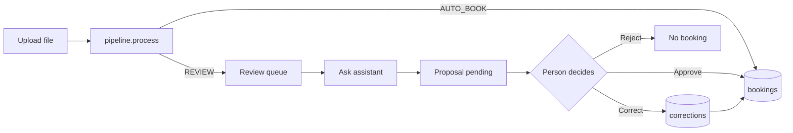

# UI brief (phase A6a)

Status: prototype for the owner's review (SPEC 8, A6a STOP). Nothing here is built into the
package yet; A6b builds the approved version.

Files:
- `docs/ui/prototype/index.html`: clickable prototype. Open it in a browser, no server needed.
- `docs/ui/prototype/strings.js`: the German/English string list (178 keys).
- `docs/ui/prototype/data.js`: fixed sample data (invented companies, valid IBAN and VAT check digits).

## Who uses it and for what

One person in accounts payable (Kreditorenbuchhaltung) at a small German company. Their job is
to clear the review queue, and to be able to see why any invoice was or was not booked
automatically. They know SKR03 accounts and § 14 UStG; they are not technical.

## Principles

1. Rules decide, the person approves. Nothing is booked without an explicit click, and the
   assistant's text is always marked as a proposal with its sources.
2. Every value shows where it came from: the XML element (BT id, XPath) or the page and the
   quote, plus the extraction confidence. Clicking a field marks its evidence in the document.
3. Reason codes appear in plain words, with the engine's own message next to them, so the
   label can be checked against what the code said.
4. German first, English by toggle. Strings come from one list; data (vendor names, rule
   messages, agent explanation, vendor email) is shown as stored, not translated.
5. The app loads only its own files: no web fonts, CDNs or trackers (DSGVO). The prototype
   follows this already.

## Screens (SPEC 3.12)

| Screen | Shows | API in A6b |
|---|---|---|
| Inbox | every invoice with received date, vendor, number, format, gross, status, first reason; filter all / to review / done; upload | `POST /invoices`; a list endpoint (open point 2) |
| Invoice view, tab Fields | document (XML tree or page image) next to the fields in three groups and the lines; evidence and confidence per field | `GET /invoices/{id}`; page image (open point 2) |
| Invoice view, tab Checks | decision, failed checks with messages, KoSIT result, GL suggestion against the 0.90 threshold, PO match table, passed checks folded | `GET /invoices/{id}` |
| Review queue | open cases with reasons and the proposed action; one case: reasons, IBAN comparison where relevant, proposal with citations and the vendor email draft, vendor history, decision | `GET /reviews`, `POST /reviews/{id}/agent`, `POST /proposals/{id}/approve`, `.../correct`, reject (open point 2) |

Statuses in the inbox: Automatisch gebucht (AUTO_BOOK), Zu prüfen (REVIEW, proposal pending or
none), Nach Prüfung gebucht (`approved`), Korrigiert gebucht (`corrected`), Abgelehnt
(`rejected`); the last three are `proposals.status` values from `001_init.sql`.

## User flows

1. Upload. The person picks a file; the inbox shows the four steps (detect, read, check,
   decide) and then the new row, booked automatically or to review.
2. Check an automatic booking. Inbox, then the invoice: fields with evidence on the left page or
   XML, then the Checks tab with every passed check and the GL probability.
3. Review a case. Review queue, then a case: why it is in review (labels plus engine messages),
   then "Ask assistant" if there is no proposal yet. The proposal shows the action, the
   explanation, the cited rule texts (click a source id to read it), the account and an email
   draft to copy. The decision buttons appear once a proposal exists, because approve and
   correct are endpoints of the proposal row (`/proposals/{id}/...`).
4. Decide.
   - Approve: shows the booking (account, net, VAT, gross, due date). If the assistant advised
     something else, a line says so; the person can still book. For `BANK_DETAILS_CHANGED`
     the button stays disabled until the person ticks that the new IBAN was confirmed with
     the vendor through a known contact (AP policy, "Bank details").
   - Correct: edits what we read (account, net, VAT, gross, due date), not the vendor's
     invoice. Net plus VAT must equal gross (checked in cents) before saving; each changed
     value becomes a `corrections` row (field, old, new) and the invoice is booked.
   - Reject: no booking; the email draft can be copied and sent by the person. The app sends
     nothing.

## Stack recommendation

FastAPI + Jinja2 templates + HTMX, with `htmx.min.js` served from the app's own static folder.
The pages are server-rendered from the same Python process as the API, so the templates can
copy the prototype's HTML almost one to one and a student can explain the whole UI without a
second language or a Node build. FastAPI and Jinja2 are already in `requirements.lock`; Jinja2
would become a direct dependency of the `api` extra and the `ui` extra with `streamlit` would be
removed. Streamlit is rejected because it reruns the whole script per click and gives no
control over the two-pane evidence layout; a React app is rejected for the Node build and the
second language.

How the prototype maps to HTMX: tabs, "Ask assistant" and the three decisions are `hx-get` or
`hx-post` requests that swap one panel; the language toggle sets a cookie and reloads; the
correction form is checked on the server (the live sum check stays as a few lines of inline
script). Marking evidence is client-side only.

## Open points for the owner (STOP)

1. Stack: approve FastAPI + Jinja2 + HTMX, or name another.
2. API gaps against SPEC 3.12, which the screens need: a list endpoint for the inbox
   (`GET /invoices`), a reject endpoint (`POST /proposals/{id}/reject`; the status exists in the
   table), and the page image for PDF and scan invoices (`GET /invoices/{id}/pages/{n}`,
   rendered with pypdfium2, already a dependency). My recommendation is to add all three in A6b
   and update SPEC 3.12 then.
3. Evidence on the page: the prototype draws the marker on an HTML page. On a real page image the
   marker needs the quote's position, from pdfplumber word positions (PDF) or tesseract word
   boxes (scan). Neither is checked yet. My recommendation: try it in A6b and, where the quote is
   not found, show the quote beside the page without a box.
4. Explanation language: the assistant explains in English (A5 prompt `review_en.txt`); the
   German UI labels it "Erklärung (englisch)". The vendor email is German. My recommendation:
   keep this until A5 live shows how well the chosen model writes German.
5. IBAN confirmation: the prototype only gates the button. My recommendation: store it as a
   `corrections` row (`field = 'iban_confirmed'`), so the audit trail shows who confirmed it.
6. Template: if you have a layout or template you want instead, A6b uses it with the same
   screens and strings.

## Not in this UI

Login and users, editing vendor master data, sending email, monitoring (Grafana, A7) and
retraining (A7). None of these is in SPEC 3.12.
